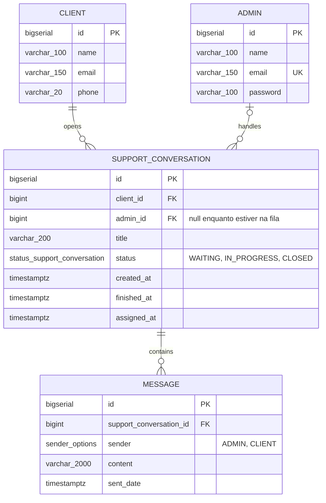

# chat-atendimento-online

Chat de atendimento online: o cliente abre um atendimento pela página inicial e ele é distribuído automaticamente para um atendente online, e a conversa acontece em tempo real via WebSocket. Fiz o backend em Spring Boot com PostgreSQL e o front em HTML/JS puro.

## Como rodar

Precisa só de **Docker** e **Docker Compose**.

```bash
docker compose up -d --build
```

Quando subir:

- Cliente: http://localhost:8080
- Atendente: http://localhost:8080/admin.html

Ver os logs da aplicação:

```bash
docker compose logs -f app
```

Parar:

```bash
docker compose down      # para os containers e mantém os dados
docker compose down -v   # para e APAGA o banco (remove o volume)
```

O `.env` é opcional. Sem ele o compose usa os valores padrão e funciona sem precisar editar nada. Se quiser trocar usuário/senha do banco ou o segredo do JWT, copie o `.env.example` para `.env` e ajuste.

As migrations (Flyway, spring boot) rodam sozinhas quando a aplicação sobe, inclusive o seed dos atendentes.

## Como testar

Os atendentes já vêm criados pelo seed (não tem cadastro, como o desafio pede):

```
messias@suporteprosistemas.com
fran@suporteprosistemas.com
pedro@suporteprosistemas.com
```

Senha de todos: `senha123`

Roteiro que eu uso para testar:

1. Abra http://localhost:8080/admin.html e entre com um atendente.
2. Em outra aba (ou janela anônima), abra http://localhost:8080 e abra um atendimento como cliente.
3. O atendimento aparece para o atendente e os dois já conseguem conversar.
4. Para ver a distribuição, entre com mais de um atendente em abas diferentes e abra vários atendimentos: cada um vai para o atendente com menos atendimentos em andamento e, no empate, para o que está há mais tempo sem receber um.
5. Se nenhum atendente estiver online, o atendimento fica na fila (`WAITING`) e é distribuído assim que algum atendente conectar.
6. O atendente finaliza o atendimento e o cliente recebe a mudança de status. Depois de finalizado, mensagens novas são rejeitadas.

## Arquitetura

- **Java 21 + Spring Boot 3.5**, Spring Data JPA, Flyway, autenticação com JWT.
- **PostgreSQL 15**.
- **Front**: HTML, JS puro, Bootstrap e StompJs.

Dividi assim:

- **REST** para o que é pedido e resposta: login do atendente, abrir atendimento, buscar atendimento, histórico de mensagens e finalizar.
- **WebSocket (STOMP)** para o que é tempo real: envio de mensagens, aviso de novo atendimento para o atendente e mudança de status para o cliente.

A presença dos atendentes é controlada pelas sessões do WebSocket: quando o atendente conecta ele entra na lista de online e a fila de espera é redistribuída; quando desconecta ele sai.

## Modelo de dados

No código, **admin = atendente**. Eu usei `admin` nas tabelas e classes, mas é a mesma coisa que "atendente" no desafio.



Índices:

| Índice | Colunas | Para quê |
|---|---|---|
| `idx_message_conversation_sent_date` | `message (support_conversation_id, sent_date)` | histórico de mensagens já ordenado |
| `idx_support_conversation_admin_status` | `support_conversation (admin_id, status)` | contar os atendimentos em andamento de cada atendente |
| `idx_support_conversation_status_created_at` | `support_conversation (status, created_at)` | pegar a fila de espera na ordem de chegada |
| `idx_support_conversation_admin_assigned_at` | `support_conversation (admin_id, assigned_at)` | achar a última atribuição de cada atendente |

## Decisões técnicas

**Distribuição dos atendimentos.** Foi o maior desafio do projeto. A regra é mandar o atendimento novo para o atendente online com menos atendimentos em andamento e, no empate, para o que está há mais tempo sem receber um. Minha primeira versão fazia uma consulta por atendente e filtrava o resultado na aplicação com stream, ou seja, um N+1, e ainda não tinha critério de desempate. Troquei por uma consulta só, que já traz o atendente certo ordenando por carga e depois pela última atribuição ([AdminRepository.java](src/main/java/prosistemas/support/chat/repository/AdminRepository.java), chamada em `choseFreeAdminByOciosityOrder()` no [SupportConversationService.java](src/main/java/prosistemas/support/chat/service/SupportConversationService.java)).

**Por que `assigned_at` e não `created_at`.** No começo eu usava o `created_at` do atendimento para saber há quanto tempo o atendente estava ocioso, mas isso erra quando a fila é esvaziada: um atendimento criado há muito tempo e atribuído agora fazia parecer que o atendente estava parado há horas. Por isso criei a coluna `assigned_at`, que guarda o momento em que o atendimento foi de fato atribuído, e um índice em `(admin_id, assigned_at)` para não precisar percorrer todo o histórico do atendente a cada atribuição.

**Redis.** Pensei em usar, mas com uma instância só o Postgres com os índices certos atende bem. O Redis faria sentido se a aplicação rodasse em várias instâncias atrás de um load balancer: para compartilhar a presença dos atendentes entre elas e para o pub/sub das mensagens, já que o broker simples do Spring e o `synchronized` só funcionam dentro de uma instância.

**Branch.** Sei que não é boa prática desenvolver direto na `main`, mas deixei tudo nela para facilitar acompanhar meu raciocínio pelos commits.

## Limitações conhecidas

- Roda em uma instância só: a presença dos atendentes fica em memória, a distribuição usa `synchronized` e o broker do WebSocket é o simples do Spring.
- Não tem limite de atendimentos simultâneos por atendente; a distribuição só equilibra a carga.
- Testes automatizados ficaram de fora.

## Endpoints

REST:

| Método | Rota | Descrição |
|---|---|---|
| POST | `/api/admins/login` | login do atendente, retorna o JWT |
| GET | `/api/admins/me/support_conversation` | atendimentos em andamento do atendente logado |
| POST | `/api/support-conversations` | cliente abre um atendimento |
| GET | `/api/support-conversations/{id}` | busca um atendimento |
| GET | `/api/support-conversations/{id}/messages` | histórico de mensagens |
| POST | `/api/support-conversations/{id}/finish` | finaliza o atendimento |

WebSocket (endpoint `/ws`):

| Destino | Tipo | Descrição |
|---|---|---|
| `/app/support-conversations/{id}/messages` | envio | manda uma mensagem no atendimento |
| `/topic/support-conversations/{id}` | inscrição | mensagens do atendimento |
| `/topic/support-conversations/{id}/status` | inscrição | mudança de status do atendimento |
| `/user/queue/support-conversations` | inscrição | novo atendimento atribuído ao atendente |

## Uso de IA

Usei IA como mentor técnico: revisão do meu código apontando problemas, diagnóstico de erros a partir dos logs, discussão de arquitetura (por exemplo o `assigned_at` e os índices) e indicação de documentação. Todo o código foi escrito por mim.

## Créditos

- [Bootstrap](https://getbootstrap.com/) para o layout.
- [StompJs](https://stomp-js.github.io/) para o cliente WebSocket no front.
